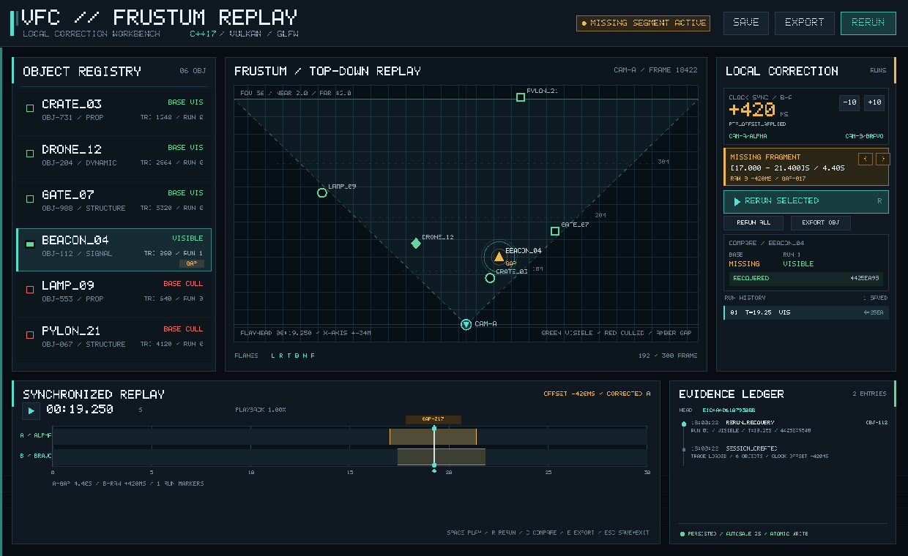

# VFC Replay / 视锥体裁剪回放局部修正工具

一个基于 **C++17 + Vulkan + GLFW** 的本地回放工作台，用于处理两台设备时钟不同步导致的缺失片段。每个渲染对象都可以单独重跑、与基线比较，并导出为同事可独立复核的证据包。



## 核心能力

- **双时钟缺失片段**：记录 A/B 设备的 B-A 时钟偏移，标出 `GAP-017` 缺失窗口；可在界面内调整偏移和缺失窗口起点。
- **对象级回放**：六个对象分别保留基线、重跑历史和确定性输入哈希；选中对象可用 `R` 单独重跑，也可 `A` 全部重跑。
- **比较**：基线状态、指定重跑结果、`MATCH / CHANGED / RECOVERED` 结论和历史运行可直接切换。
- **退出与恢复**：会话每 2 秒原子保存到 `.vfcr/session.json`，正常退出时再次保存；重新进入后恢复选择、播放头、运行历史和证据链。
- **可复核导出**：导出 `record.json`、Vulkan 帧截图 `frame.ppm` 和 `REVIEW.md`；记录包含场景、相机、时钟、缺失片段、每个对象的运动参数、每次重跑输入和完整断言。
- **独立验证器**：`vfcr-verify` 不依赖 GUI、Vulkan 或会话文件，重新计算视锥可见性、输入哈希、证据链和记录 SHA-256。
- **字段与顺序稳定**：对象、运行、证据和会话字段由固定顺序写出；记录中的 `reloadContract` 明确列出字段顺序，重新载入时校验并保持该顺序。

## 快速开始

系统依赖：

```sh
sudo apt install build-essential cmake libvulkan-dev libglfw3-dev
./scripts/build.sh
./build/vfcr
```

本工作区已经解包了本地依赖，可直接使用：

```sh
VFCR_DEPS_ROOT="$PWD/.deps/root" ./scripts/build.sh
VFCR_DEPS_ROOT="$PWD/.deps/root" ./scripts/run.sh
```

如果桌面环境同时暴露 Wayland 和 XWayland，可强制 GLFW 使用 X11 以便抓屏或调试：

```sh
VCFR_X11=1 ./scripts/run.sh
```

## 操作

| 操作 | 行为 |
| --- | --- |
| 点击对象行 / `↑` `↓` | 选择渲染对象 |
| `R` | 在当前播放头重跑选中对象 |
| `A` | 为六个对象分别追加一次重跑 |
| `C` | 在基线与各次运行之间切换比较 |
| 点击时间线 / 拖动光标 | 跳转播放头 |
| `Space` | 播放或暂停 |
| `E` | 导出完整会话记录 |
| `Shift+E` | 导出选中对象为重点的证据包 |
| 缺失片段卡片 `<` `>` / `[` `]` | 平移缺失窗口，保留已有证据 |
| 时钟卡片 `-10` `+10` / 滚轮 | 调整 B-A 时钟偏移 |
| `S` | 立即原子保存 |
| `Esc` | 保存并退出 |

窗口正常关闭也会保存。自动保存周期为 2 秒。

## 导出与独立复核

每次导出生成一个目录：

```text
exports/<UTC时间>-<帧号>-<序号>[-<对象ID>]/
├── record.json
├── frame.ppm
└── REVIEW.md
```

复核只需要验证器：

```sh
./build/vfcr-verify exports/<bundle>/record.json
```

验证内容包括：

- `recordFormat` 和 `reloadContract`；
- 对象、运行、证据字段顺序和运行序号；
- 相机、对象运动参数到端点 A 时间样本的视锥重算；
- 每次运行的 `inputHash`；
- 证据链 `previous -> digest`，以及链头；
- 记录规范化后的 SHA-256；
- 截图文件 SHA-256。

仓库内附有可直接验证的示例：

```sh
./build/vfcr-verify examples/beacon-recovery/record.json
```

载入已经导出的记录并再次保存会话：

```sh
./build/vfcr --open examples/beacon-recovery/record.json
```

载入时会先完整验证记录，再恢复对象顺序、运行顺序、比较序号、播放头和证据链。重新写出的会话保持相同的字段顺序。

## 数据说明

`record.json` 顶层同时保留会话字段和导出元数据：

- `clockReview`：`offsetBMinusAMs`、修正公式、原始 B 时间窗口；
- `missingFragmentReview`：A 时间缺失窗口、来源和恢复策略；
- `exportScope`：完整会话或选中对象重点；
- `reloadContract`：四类字段的有序清单；
- `assertions`：导出时逐项生成的通过/失败断言；
- `integrity.recordSha256`：去除 `integrity` 后按 `vfcr-json-v1` 规范化计算的 SHA-256。

对象重跑不依赖当前 GUI 状态或设备时间，只依赖：

- 相机参数；
- 对象基准位置、包围盒、运动参数；
- 修正后的 A 时间样本 `sampleA`；
- 该次运行记录的时钟偏移。

因此同事可从记录中独立重算可见性。每次运行同时保存 `inputHash`，用于定位输入是否发生变化。

## 工程结构

```text
src/core/      保序 JSON、SHA-256、场景模型、视锥裁剪、会话和导出
src/app/       Vulkan 交换链/UI 管线/帧回读、GLFW 输入、界面和交互
src/verify/    无 GUI 独立复核 CLI
shaders/       UI 顶点与片元着色器源码
assets/        已编译的 SPIR-V
tests/         核心数据、重跑、导出和重载测试
examples/      可独立验证的示例证据包
```

UI 由 Vulkan 动态三角形顶点缓冲绘制，包括程序内嵌 5x7 字模、视锥示意、双轨时间线、对象状态和证据账本。截图通过交换链 `TRANSFER_SRC` 回读生成，不依赖桌面抓屏。

## 测试

```sh
ctest --test-dir build --output-on-failure
```

测试覆盖：

- JSON 字段插入顺序与重载保持；
- SHA-256 已知向量；
- 缺失对象基线、恢复运行、证据链；
- 缺失窗口平移不改时长；
- 完整/单对象导出；
- 规范哈希、截图哈希、字段顺序验证；
- 记录重载后的对象字段顺序和运行顺序；
- 篡改记录被验证器拒绝。
